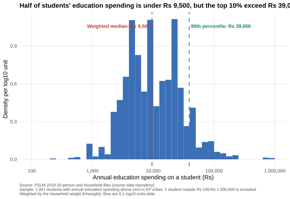
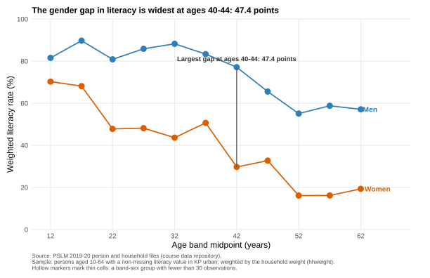

# ECO346-A1-FA24-BEDS-105

**Data Visualization Techniques for Economists - Assignment 1 (Fall 2026)**

| | |
|---|---|
| **Registration number** | FA24-BEDS-105 |
| **Variant** | **5** = Khyber Pakhtunkhwa, urban (prov_code 1, urban_rural 2) |
| **Second language (Question 5)** | Python (pandas + matplotlib) |
| **Data** | PSLM 2019-20 person and household files (subset), in `data/` |

The variant is the last two digits of the registration number, `05`, taken modulo 8: `05 = 0 x 8 + 5`, so variant 5. Every figure and number below uses only persons and households in **KP urban**; every statistic is weighted by the household weight `hhweight`, attached from the household file by `hhid`.

---

## How to reproduce everything

No internet connection and no manual step are required. From the repository root:

```bash
Rscript scripts/run_all.R          # runs scripts 01-03 in R, then 04 in Python
```

Individual scripts:

| Script | Question | Output |
|---|---|---|
| `scripts/01_default.R` | 4 (default) | `figures/default.svg` |
| `scripts/02_distribution.R` | 2 | `figures/distribution.svg` |
| `scripts/03_literacy.R` | 3 (redesign) | `figures/literacy.svg` + band table |
| `scripts/04_literacy.py` | 5 | `figures/literacy_python.svg` + band table |
| `scripts/build_slides.py` | 6 | `slides/FA24-BEDS-105.pptx` (rebuilds the slides) |

Required R packages: `ggplot2`, `svglite`, `dplyr`. Required Python packages: `numpy`, `pandas`, `matplotlib`; `build_slides.py` additionally uses `python-pptx` and `svglib`/`reportlab` to rasterise the PNG fallbacks. All figures are written as **SVG** by the script that draws them.

The weighted *q*-th quantile follows the assignment definition exactly: sort by the variable, accumulate the weight share, and take the smallest value at which the cumulative share reaches or exceeds *q* (R's built-in `quantile()` is not used).

---

## Question 2 - The distribution of education spending



**The figure.** A weighted histogram of annual education spending on students in KP urban, drawn on a log scale (bins 0.1 log10 units wide, from Rs 100 to Rs 1,000,000). The vertical axis is density per log10 unit; the horizontal axis is labelled in rupees at each power of ten. Dashed lines mark the weighted median and the weighted 90th percentile.

**Reported numbers.**

| Quantity | Value |
|---|---|
| Students (ed_total > 0) | 1,061 |
| Students analysed (Rs 100 - Rs 1,000,000) | 1,060 |
| Students excluded (outside the range) | 1 |
| Weighted median | Rs 9,500 |
| Unweighted median | Rs 10,100 |
| Weighted 10th percentile | Rs 3,150 |
| Weighted 90th percentile | Rs 39,000 |
| Ratio of 90th to 10th percentile | 12.38 |

**What it shows (<= 80 words).** Education spending is right-skewed even in logs: the median student costs about Rs 9,500 a year, but the top tenth exceeds Rs 39,000, more than twelve times the 10th percentile. The weighted median (Rs 9,500) is below the unweighted median (Rs 10,100) because households with lower spending receive larger weights, pulling the weighted centre down. The near-thousand-rupee gap is small, so the two samples are similar in shape.

---

## Question 3 - The relationship between literacy and age



**The figure.** The weighted literacy rate against five-year age bands (plotted at band midpoints), with women and men as two series of markers joined by lines. Each series is labelled directly at its end; there is no legend. Hollow markers mark thin cells (a band-sex group with fewer than 30 observations). The widest gap between women and men is annotated directly.

**Full band table.** Counts and weighted literacy rates (%) by age band and sex.

| Age band | Men, n | Men, % | Women, n | Women, % |
|---|---|---|---|---|
| 10-14 | 228 | 81.5 | 215 | 70.3 |
| 15-19 | 193 | 89.7 | 163 | 68.1 |
| 20-24 | 149 | 80.8 | 129 | 47.8 |
| 25-29 | 112 | 85.9 | 135 | 48.1 |
| 30-34 | 89 | 88.2 | 126 | 43.6 |
| 35-39 | 116 | 83.3 | 105 | 50.7 |
| 40-44 | 100 | 77.1 | 110 | 29.7 |
| 45-49 | 67 | 65.5 | 60 | 32.8 |
| 50-54 | 53 | 55.1 | 50 | 16.1 |
| 55-59 | 41 | 58.8 | 41 | 16.2 |
| 60-64 | 44 | 57.1 | 31 | 19.3 |

No band-sex cell falls below 30 observations, so no marker is hollow in this variant.

**Reported numbers.**

| Quantity | Value |
|---|---|
| Women aged 15-19 | 68.1 % |
| Men aged 15-19 | 89.7 % |
| Women aged 55-59 | 16.2 % |
| Men aged 55-59 | 58.8 % |
| Band with the largest gap | **40-44** (47.4 points) |

**Interpretation (<= 100 words).** Literacy rises with age for both sexes but the two series diverge sharply after the teenage years. Men are literate from early on (around 90% at 15-19) and stay high until middle age, while women's literacy collapses across the life course, from 68% at 15-19 to about 16% at 55-59. The widest gap is at ages 40-44, where men's rate (77.1%) exceeds women's (29.7%) by 47.4 points. This pattern is consistent with older cohorts of women having been excluded from schooling. The figure cannot tell us *why*: it shows no income, school supply, or cohort history, only an age profile.

---

## Question 4 - The makeover

The default figure (`figures/default.svg`, committed first) is `ggplot(data, aes(age, literate)) + geom_point()` with R's defaults untouched. The redesign is the Question 3 figure (`figures/literacy.svg`).

**Explanation of the redesign (<= 150 words).** Three changes, each tied to a principle from Chapters 1-4. First, the raw scatter is replaced by **conditional means**: the weighted literacy rate within each five-year band, because averages reveal the age pattern that thousands of overlapping points hide (**overplotting**). Second, position is used for the rate and age while **line + shape channels** carry sex, since these encode quantitative and categorical information more accurately than the two-valued vertical position of a binary dot (**perceptual ranking of channels**). Third, the design strips non-data ink - no legend, direct end labels instead - and lets the series carry colour, raising the **data-ink ratio**. The default figure, however, shows the actual spread and the discreteness of the 0/1 outcome, which the redesign hides by plotting only one summary value per cell.

---

## Question 5 - A second language (Python)

`scripts/04_literacy.py` recomputes the Question 3 band table and redraws the figure in Python, saved as `figures/literacy_python.svg`. The two band tables agree to one decimal place across all eleven bands.

**Reported numbers.** The literacy rate of **women aged 15-19** is **68.1%** from R and **68.1%** from Python.

**One difference and how it was fixed (<= 80 words).** The default axis range differed: R's `scale_y_continuous(limits = c(0, 100))` and matplotlib's automatic limits did not agree, so the two figures would not overlay. I set explicit `xlim(10, 65)` and `ylim(0, 100)` in Python to match the R plot. Marker style also differs by default, so hollow markers are drawn explicitly for thin cells in both languages.

---

## Repository structure

```
ECO346-A1-FA24-BEDS-105/
+-- README.md
+-- data/       pslm_person_subset.csv, pslm_hh_subset.csv
+-- scripts/    01_default.R, 02_distribution.R, 03_literacy.R,
+               04_literacy.py, build_slides.py, run_all.R
+-- figures/    default.svg, distribution.svg, literacy.svg, literacy_python.svg
+-- slides/     FA24-BEDS-105.pptx
```
